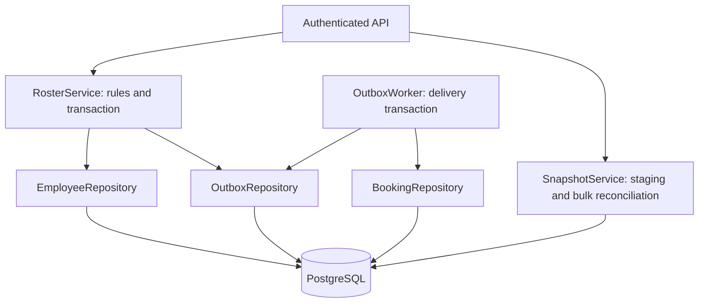

# HR Roster Sync

A Java backend for **MoveInSync Case Study 5**: synchronize employee data from live HR events and nightly exports despite duplicates, out-of-order delivery, invalid records, incomplete files, and crashes.

**Stack:** Java 21, Spring Boot, PostgreSQL, Spring JDBC, Spring Batch, Spring Security, Flyway, Actuator, JUnit, Testcontainers, and Spotless.

## Reviewer walkthrough

Follow the sections in order. No frontend is required; the examples exercise the API directly.

1. [Start the application](#1-start-the-application)
2. [Evaluate the safety brake](#2-evaluate-the-safety-brake)
3. [Run the live-event demo](#3-run-the-live-event-demo)
4. [Trace requirements to evidence](#4-trace-requirements-to-evidence)
5. [Inspect the design patterns and code](#5-inspect-the-design-patterns-and-code)
6. [Run tests and failure checks](#6-run-tests-and-failure-checks)
7. [Review measured performance](#7-review-measured-performance)
8. [Read assumptions and trade-offs](#8-read-assumptions-and-trade-offs)
9. [API reference](#9-api-reference)
10. [Development and submission notes](#10-development-and-submission-notes)

## 1. Start the application

Prerequisite: Docker with Compose and a running Docker engine. Java/Maven are not required on the host for this command.

```sh
docker compose up --build -d
docker compose ps
curl http://localhost:8080/actuator/health
```

Wait for health to return `{"status":"UP"}`. The backend listens on port 8080; there is no dashboard at `/`. Use `curl.exe` in Windows PowerShell when `curl` resolves to a PowerShell alias.

Useful commands:

```sh
docker compose logs --tail=100 app
docker compose down
```

Stopping Compose preserves the PostgreSQL volume. **The fixture walkthrough below assumes a new demo database.** If using an existing database, inspect its records and watermark first; repeated examples can correctly return IGNORED/STALE instead of their initial-run results. Do not delete a volume containing data you need.

| User | Role | Permitted operations |
|---|---|---|
| `acme-hr` | HR | Submit live events, upload CSV, resume staged runs |
| `acme-admin` | Admin | Edit transport fields and create bookings |
| `acme-operator` | Operator | Approve blocked imports, inspect/retry outbox, view metrics |
| `globex-hr`, `globex-admin`, `globex-operator` | Same roles | Access only globex data |

Demo password: **`local-demo-password`**. Seeded offices: acme has BLR/HYD; globex has BLR. Tenant identity comes from authentication, not a caller-provided tenant parameter.

## 2. Evaluate the safety brake

Run this **before** the general demo or benchmark on a fresh database.

**A. Create two active employees.**

```sh
curl -u acme-hr:local-demo-password -H "Content-Type: application/json" --data-binary @examples/events.json http://localhost:8080/api/events
```

Expected: two `APPLIED` results.

**B. Upload a snapshot containing only one employee.**

```sh
curl -u acme-hr:local-demo-password -F file=@examples/snapshot.csv "http://localhost:8080/api/snapshots?watermark=10"
```

Expected: `status=BLOCKED`, `active_before=2`, `missing=1`. A 50% missing ratio exceeds the default 30% threshold. Copy the returned `id` as `RUN_UUID`.

**C. Confirm the missing employee is still active.**

```sh
curl -u acme-hr:local-demo-password http://localhost:8080/api/employees/E002
```

Expected: `active=true`. The blocked import has not applied employee changes.

**D. Approve after reviewing the source file.**

Replace `RUN_UUID` below with the returned ID:

```sh
curl -u acme-operator:local-demo-password -H "Content-Type: application/json" --data-binary @examples/approval.json http://localhost:8080/api/snapshots/RUN_UUID/approve
curl -u acme-hr:local-demo-password http://localhost:8080/api/employees/E002
```

Expected: run `COMPLETED`, recorded approval reason, and E002 `active=false`. Uploading the same snapshot/watermark again returns `STALE` with no additional employee effects.

## 3. Run the live-event demo

Requires Python 3, standard library only:

```sh
python scripts/demo.py
```

Review its output in this order:

| Step | Expected evidence |
|---|---|
| Create DEMO1 | APPLIED |
| Replay identical event | IGNORED / STALE_OR_DUPLICATE |
| Edit transport preferences | UPDATED |
| Create a future booking | Booking UUID returned |
| Deactivate DEMO1 | APPLIED |
| Inspect bookings | CANCELLED and seat_reserved=false |
| Inspect outbox | Events have delivered_at timestamps |

The script uses synthetic data and current source revisions. It can run after the safety-brake walkthrough.

## 4. Trace requirements to evidence

Test methods are in [RosterIntegrationTest.java](src/test/java/com/moveinsync/roster/RosterIntegrationTest.java).

| Requirement | Implementation | Automated evidence |
|---|---|---|
| Per-record validation | Models.validate and API record parsing | badRecordDoesNotFailBatchAndTenantIsolation; missingAndWrongTypeVersionsArePerRecordErrors |
| Duplicate/stale protection | RosterService version and watermark decisions | duplicateStaleAndOwnership |
| Preserve admin-owned fields | EmployeeRepository HR update excludes transport columns | duplicateStaleAndOwnership |
| Concurrent correctness | Service-owned transaction and tenant row lock | concurrentUpdatesKeepHighestVersion; liveUpdateRacingSnapshotRemainsNewest |
| Large nightly diff | SnapshotService streams batches of 1,000 into staging; SQL joins compare versions | 200,000-row benchmark; csvEndpointRunsBatchJob |
| Missing-record safety brake | SnapshotService threshold and approval checks | safetyBrakeApprovalAndReplay |
| Invalid exports remain safe | Invalid/duplicate rows suppress absence deactivation | invalidSnapshotRowsNeverCauseDeactivation; unknownOfficeAndDuplicateRowsReported |
| Preserve newer live state | Snapshot watermark | newerLiveUpdatesSurviveOldSnapshot |
| Atomic employee + event write | EmployeeRepository and OutboxRepository in one service transaction | databaseFailureRollsBackEmployeeAndOutboxTogether |
| Reliable cancellation and seat release | OutboxWorker, inbox receipt, BookingRepository | outboxSurvivesPublisherAbsenceAndDeduplicates |
| Retry without partial effects | Worker transaction/savepoint and durable retry schedule | outboxRetriesWithoutPartialEffects |
| Tenant and role isolation | Spring Security + tenant-scoped queries | badRecordDoesNotFailBatchAndTenantIsolation |
| Real process recovery | Durable pending outbox after JVM termination | [crash recovery result](docs/crash-recovery-results.json) |
| Monitoring and privacy | Actuator metrics, structured identifiers, sanitized errors | Inspect metrics/logs; invalid-value response assertion |

## 5. Inspect the design patterns and code



| Pattern | Concrete use | Why it is useful here |
|---|---|---|
| Repository | EmployeeRepository, OutboxRepository, BookingRepository | Removes persistence details from live-ingestion decisions and outbox delivery orchestration |
| Transactional Outbox | Employee write and pending event in the same transaction | A crash cannot commit the employee without its change event |
| Idempotent Consumer / Inbox | Unique consumed_events receipt | Replayed delivery does not repeat side effects |
| Staging Table | Validate and compare a file before applying it | Allows safe impact assessment and operator approval |
| Dependency Injection | Constructor-injected Spring components | Explicit dependencies without factories or service locators |

**Transactions stay in the service/worker.** Repositories do not start independent transactions. The employee write and outbox insert share one transaction; the consumption receipt, cancellation, seat release, and delivery marker share another. Retry savepoint behavior is preserved.

Suggested code-reading order:

1. [Models.java](src/main/java/com/moveinsync/roster/Models.java): request types and pure validation.
2. [RosterService.java](src/main/java/com/moveinsync/roster/RosterService.java): business decisions and transaction boundary.
3. [EmployeeRepository.java](src/main/java/com/moveinsync/roster/EmployeeRepository.java): tenant lock, version reads, and ownership-preserving writes.
4. [OutboxRepository.java](src/main/java/com/moveinsync/roster/OutboxRepository.java), [OutboxWorker.java](src/main/java/com/moveinsync/roster/OutboxWorker.java), and [BookingRepository.java](src/main/java/com/moveinsync/roster/BookingRepository.java): delivery and recovery.
5. [SnapshotService.java](src/main/java/com/moveinsync/roster/SnapshotService.java): CSV staging, safety brake, watermark and bulk application.
6. [Security.java](src/main/java/com/moveinsync/roster/Security.java), [Api.java](src/main/java/com/moveinsync/roster/Api.java), and [schema](src/main/resources/db/migration/V1__schema.sql): access, endpoints and constraints.

The extraction is intentionally scoped: bulk reconciliation SQL remains in SnapshotService, and simple API administrative queries remain in Api. No generic base repository, one-implementation interface hierarchy, or event framework was added. See the [design note](docs/design.md) for the harder sequence diagram, failure-mode table, complexity, and scaling limits.

## 6. Run tests and failure checks

With Java 21, Maven, and a running Docker engine:

```sh
mvn verify
```

This checks formatting and runs the tests using a PostgreSQL Testcontainer by default. Alternatively set `TEST_DB_URL`, `TEST_DB_USER`, and `TEST_DB_PASSWORD` for a **dedicated disposable database**: the integration tests truncate application tables there.

The recorded native PostgreSQL verification has **14 passing tests**. See [verification details](docs/verification.md) for exactly what was executed; Compose execution and Testcontainers execution are separate checks.

An actual kill/restart check is provided for Windows:

```powershell
.\scripts\crash-recovery.ps1 -Java "C:\path\to\jdk-21\bin\java.exe" -DatabaseUrl "jdbc:postgresql://127.0.0.1:55432/roster_failure"
```

Build the JAR first and provision that dedicated database with the configured credentials. The script starts its own app on port 8081 with publishing paused, commits changes, kills its JVM, restarts with the worker enabled, and asserts cancellation/seat release. It stops only its own app process.

## 7. Review measured performance

| Measurement | Recorded result |
|---|---:|
| Initial 200,000-row import | 13.457 seconds |
| Unchanged 200,000-row reconciliation | 10.767 seconds; zero employee changes |
| Event API sample | 100 requests, concurrency 8 |
| Event API latency | p50 172.34 ms; p99 602.13 ms |
| Application JVM heap cap | 256 MiB |

These are recorded pre-refactor measurements, not new measurements of the repository extraction. The full [verification report](docs/verification.md) includes hardware, memory scope, raw results, and limitations. The snapshot benchmark disabled outbox delivery to isolate import/reconciliation; no 200,000-event delivery throughput claim is made.

To reproduce on a dedicated fresh application database:

```sh
python scripts/benchmark.py
python scripts/load-events.py
```

The scripts write JSON results under `docs/`. Do not mix a benchmark dataset with the small safety-brake fixture walkthrough.

## 8. Read assumptions and trade-offs


* The HR source provides a **tenant-wide monotonically increasing revision stream**, and each event carries the revision at which that employee last changed. Gaps are allowed. A snapshot watermark means the file is complete through that source revision. Timestamps and independent per-employee counters need an adapter; they are not interchangeable with this contract.
* Employee updates are ordered by source version. Equal/older versions are no-ops; an event's logical identity is `(tenant, employee, version)`. The source must never reuse a version for different content. Full-state events make skipping stale events safe.
* A tenant row lock serializes HR changes, booking creation, and snapshot application. Version checks, data updates, and outbox writes commit together. Different tenants use different locks. This favors clear correctness over maximum same-tenant write throughput.
* HR owns name, email, phone, manager, office, shift, and active status. Admin owns pickup point and assistance. HR SQL never writes admin fields.
* A deactivation received before an employee's creation creates a tombstone. An older creation cannot resurrect it.
* Snapshot rows stream into PostgreSQL in batches of 1,000; the JVM never loads the complete database or file. A per-import office set avoids one lookup per CSV row. Indexed joins and version comparison implement the diff; hash bucketing is unnecessary with this source-version contract.
* Missing active employees at or above `MISSING_THRESHOLD` (default 0.30) block **all application** until operator approval. An empty export is subject to the same check. Invalid or duplicate rows produce a PARTIAL run: valid rows can apply, but absence-based deactivation and watermark advancement are disabled, even with approval.
* Newer live records survive older snapshots. Successful snapshots establish a watermark that prevents delayed pre-snapshot events from resurrecting absent employees. Replaying a completed run or an already-consumed watermark causes no employee effects.
* The outbox worker is an in-process downstream booking consumer backed by PostgreSQL, not an external broker. It records a durable inbox receipt, cancels future bookings, releases reserved seats, and marks delivery in one transaction. Duplicate delivery is harmless. A delayed deactivation does not cancel bookings created after the deactivation event.
* Failed delivery rolls back to a savepoint and schedules exponential backoff plus jitter. After 10 failures the row remains undelivered for operator inspection/retry. Workers use `FOR UPDATE SKIP LOCKED` for safe concurrent claiming.
* Raw record values never appear in error reports or application event logs. Employee IDs, tenant IDs, run IDs, status and error codes are used. Read APIs intentionally expose authorized tenant records.


## 9. API reference


| Method and path | Purpose |
|---|---|
| POST `/api/events` | Array of 1–1,000 full HR records; per-record APPLIED / IGNORED / REJECTED results |
| GET `/api/employees?after=E001&limit=100` | Keyset-paginated tenant records; maximum 200 |
| GET `/api/employees/{id}` | One employee |
| PATCH `/api/employees/{id}/transport` | Admin-owned `pickupPoint` and `assistance` |
| POST `/api/snapshots?watermark=123` | Multipart `file`; CSV upload and synchronous reconciliation |
| GET `/api/snapshots` | Latest 100 runs and safety status |
| GET `/api/snapshots/{id}` | Counts, status, and approval audit |
| GET `/api/snapshots/{id}/errors?after=0` | Paginated record errors, codes and IDs only |
| POST `/api/snapshots/{id}/approve` | Operator approval with `reason`; rechecks current data |
| POST `/api/snapshots/{id}/resume` | HR retry of a fully staged run after apply failure |
| POST `/api/bookings` | Admin: `employeeId`, future ISO-8601 `startsAt` |
| GET `/api/bookings` | Latest 200 tenant bookings |
| GET `/api/outbox` | Operator: latest 200 tenant events and delivery state |
| POST `/api/outbox/{id}/retry` | Operator resets retry budget for an undelivered event |
| GET `/actuator/metrics` | Operator-only operational metrics |

CSV columns: `employeeId,version,name,email,phone,manager,office,shift`. Snapshots list **active employees only**. Upload limit: 100 MB. A valid DEACTIVATE event needs only `employeeId`, `version`, and `type`. CREATE and UPDATE are full-state upserts, so a late CREATE cannot overwrite a newer UPDATE.


## 10. Development and submission notes

Format Java using either:

```sh
mvn spotless:apply
mvn spotless:check
```

Or, on this Windows workspace:

```powershell
.\scripts\format-java.ps1
.\scripts\format-java.ps1 -Check
```

Spotless uses pinned google-java-format in AOSP style (four spaces), import cleanup and LF endings. `mvn verify` and CI reject formatting drift. Dependencies download on first use and are subsequently cached.

The downloaded toolchain in this workspace also supports `./scripts/run-local.ps1` without Docker. That script depends on ignored local tool/database files and is a convenience for this machine; **Docker Compose is the portable reviewer entrypoint**. Stop any app occupying port 8080 before switching between native and Docker runs.

Configuration: `APP_PASSWORD`, `DB_PASSWORD`, `WORKER_ENABLED`, `MISSING_THRESHOLD` (default 0.30), and `DB_URL` for native runs. The Compose file currently forwards the first three; pass a threshold override into the app container explicitly if changing it. Demo accounts/offices are seeded. Production deployment would require TLS, organizational identity provisioning, and a retention policy.

Repository: [Ayush-Vish/HR_Roster_Sync](https://github.com/Ayush-Vish/HR_Roster_Sync). Included: source, Docker setup, fixtures, demo scripts, automated tests, design diagrams and measured results. A recorded demo video remains a submission task.

Scope limits: synchronous imports; full-state HR events; no UI, external broker, or cloud deployment; seat release modeled by the booking flag rather than a full vehicle-capacity inventory. A staging crash requires re-upload; a fully staged run can be resumed.
