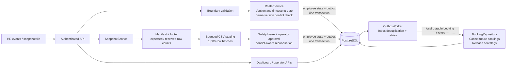

# HR Roster Sync

A Java backend for **MoveInSync Case Study 5**: synchronize employee data from live HR events and nightly exports despite duplicates, out-of-order delivery, invalid records, incomplete files, and crashes.

For a presentation-ready sequence with exact commands and narration, see [DEMO_GUIDE.md](DEMO_GUIDE.md).

**Stack:** Java 21, Spring Boot, PostgreSQL, Spring JDBC, Spring Batch, Spring Security, Flyway, Actuator, JUnit, Testcontainers, and Spotless.

**Demo video:** [Watch the five-minute technical walkthrough](https://drive.google.com/file/d/1t6JCiXjvmJo3f8TYQ3GeUgw7B_n6UlZK/view?usp=sharing).

## Contents

- [Getting started](#getting-started)
- [Quick curl verification](#quick-curl-verification)
- [Live dashboard](#live-dashboard)
- [CSV import and safety brake](#csv-import-and-safety-brake)
- [Live-event demo](#live-event-demo)
- [Features and test coverage](#features-and-test-coverage)
- [Quality attributes](#quality-attributes)
- [Architecture and design patterns](#architecture-and-design-patterns)
  - [Project structure](#project-structure)
- [Testing](#testing)
- [Performance](#performance)
- [Assumptions and trade-offs](#assumptions-and-trade-offs)
- [API reference](#api-reference)
  - [Operational metrics](#operational-metrics)
- [Development](#development)
- [Current scope](#current-scope)
- [Five-minute demo guide](DEMO_GUIDE.md)

## Getting started

Prerequisite: Docker with Compose and a running Docker engine. Java/Maven are not required on the host for this command.

```sh
docker compose up --build -d
docker compose ps
curl http://localhost:8080/actuator/health
```

Wait for health to return `{"status":"UP"}`, then open **http://localhost:8080/** for the dashboard. Use `curl.exe` in Windows PowerShell when `curl` resolves to a PowerShell alias.

## Quick curl verification

Run these commands from the repository root against a fresh demo database. They exercise health, ordered/idempotent events, the reconciliation safety brake, authentication, and an operational metric.

```powershell
curl.exe http://localhost:8080/actuator/health

curl.exe -u acme-hr:local-demo-password -H "Content-Type: application/json" --data-binary "@examples/events.json" http://localhost:8080/api/events

# Replay the same feed: both records are ignored as stale/duplicates.
curl.exe -u acme-hr:local-demo-password -H "Content-Type: application/json" --data-binary "@examples/events.json" http://localhost:8080/api/events

# The file contains one of two active employees, so the 30% safety brake blocks it.
curl.exe -u acme-hr:local-demo-password -F "file=@examples/snapshot.csv" "http://localhost:8080/api/snapshots?watermark=10"

# The same export without its footer fails before any employee application.
curl.exe -u acme-hr:local-demo-password -F "file=@examples/snapshot-truncated.csv" "http://localhost:8080/api/snapshots?watermark=11"

# Authentication and an operator-only metric.
curl.exe -i http://localhost:8080/api/employees
curl.exe -u acme-operator:local-demo-password http://localhost:8080/actuator/metrics/roster.outbox.pending
```

Expected signals are `UP`, two `APPLIED` results, two `IGNORED` results on replay, snapshot status `BLOCKED`, `SNAPSHOT_FOOTER_MISSING` for the truncated fixture, HTTP `401` without credentials, and a metric response containing a numeric value. If the database already contains demo data, reset it with `docker compose down -v` followed by `docker compose up --build -d` before repeating these exact expectations.

## Live dashboard

Choose Acme or Globex and connect with the demo password below. The dashboard uses that tenant's operator account to read state, HR account to submit events/imports, and admin account to reserve bookings. Credentials remain in browser memory and are cleared on disconnect; this is a demo workspace for the seeded accounts.

* Submit a CREATE or UPDATE with a source version or timestamp, then resend it to see the duplicate result. Use an ordering value above the tenant's existing snapshot cutoff.
* Reserve tomorrow's booking for the employee in the form, then submit a newer DEACTIVATE. Watch the outbox delivery status and the booking cancellation/seat release counts change.
* Upload a version or timestamp CSV, inspect the run's missing/error counts, and review blocked imports before approving them with an explanation.

The page polls the authenticated, tenant-scoped `/api/dashboard` endpoint every two seconds without overlapping requests. It displays persisted employee/outbox/booking/run state; submitted duplicate and rejected events appear in the result panel because they create no outbox event. Counts cover the displayed windows (200 outbox records, 200 bookings, first 200 employees, 100 imports), not tenant-wide totals. Independent queries can briefly show different commit points; the next refresh converges.

The flow diagram shows components within the existing application. Booking effects remain asynchronous through the durable outbox. The dashboard adds no frontend build step or external dependencies; Spring Boot serves the HTML, CSS, and JavaScript.

Useful commands:

```sh
docker compose logs --tail=100 app
docker compose down
```

Stopping Compose preserves the PostgreSQL volume. The sample import below assumes a fresh demo database. Existing records and watermarks can cause repeated examples to return IGNORED/STALE instead of their initial-run results.

| User | Role | Permitted operations |
|---|---|---|
| `acme-hr` | HR | Submit live events, upload CSV, resume staged runs |
| `acme-admin` | Admin | Edit transport fields and create bookings |
| `acme-operator` | Operator | Approve blocked imports, inspect/retry outbox, view metrics |
| `acme-employee-E001` | Employee | Read only employee E001's profile through `/api/me/employee` |
| `globex-hr`, `globex-admin`, `globex-operator` | Same roles | Access only globex data |

Demo password: **`local-demo-password`**. Seeded offices: acme has BLR/HYD; globex has BLR. Tenant identity comes from authentication, not a caller-provided tenant parameter.

## CSV import and safety brake

The sample files demonstrate an import that would deactivate half the active employees. These expected results assume a fresh database with no prior demo or benchmark records.

The event fixture creates two active employees:

```sh
curl -u acme-hr:local-demo-password -H "Content-Type: application/json" --data-binary @examples/events.json http://localhost:8080/api/events
```

Expected: two `APPLIED` results.

The CSV fixture contains only one of those employees:

```sh
curl -u acme-hr:local-demo-password -F file=@examples/snapshot.csv "http://localhost:8080/api/snapshots?watermark=10"
```

Expected: `status=BLOCKED`, `active_before=2`, `missing=1`. A 50% missing ratio exceeds the default 30% threshold. Copy the returned `id` as `RUN_UUID`.

The missing employee remains active while the import is blocked:

```sh
curl -u acme-hr:local-demo-password http://localhost:8080/api/employees/E002
```

Expected: `active=true`. The blocked import has not applied employee changes.

An operator can approve the import after confirming the source file is complete.

Replace `RUN_UUID` below with the returned ID:

```sh
curl -u acme-operator:local-demo-password -H "Content-Type: application/json" --data-binary @examples/approval.json http://localhost:8080/api/snapshots/RUN_UUID/approve
curl -u acme-hr:local-demo-password http://localhost:8080/api/employees/E002
```

Expected: run `COMPLETED`, recorded approval reason, and E002 `active=false`. Uploading the same snapshot/watermark again returns `STALE` with no additional employee effects.

## Live-event demo

Requires Python 3, standard library only:

```sh
python scripts/demo.py
```

The script demonstrates the following behavior:

| Operation | Result |
|---|---|
| Create DEMO1 | APPLIED |
| Replay identical event | IGNORED / DUPLICATE |
| Edit transport preferences | UPDATED |
| Create a future booking | Booking UUID returned |
| Deactivate DEMO1 | APPLIED |
| Inspect bookings | CANCELLED and seat_reserved=false |
| Inspect outbox | Events have delivered_at timestamps |

The script uses synthetic data and current source revisions. It is compatible with the data created by the CSV example.

## Features and test coverage

Test methods are in [RosterIntegrationTest.java](src/test/java/com/moveinsync/roster/RosterIntegrationTest.java).

| Feature | Implementation | Test coverage |
|---|---|---|
| Per-record validation | Models.validate and API record parsing | badRecordDoesNotFailBatchAndTenantIsolation; missingAndWrongTypeVersionsArePerRecordErrors |
| Snapshot completeness | Required expected-row manifest and matching footer | snapshotEnvelopeDetectsMissingFooterAndCountMismatches; csvEndpointRunsBatchJob |
| Malformed CSV containment | Header and row-shape validation | malformedCsvRowDoesNotAffectValidRows; duplicateCsvHeadersAreRejectedBeforeApplication |
| Duplicate/stale/conflict protection | RosterService state comparison and watermark decisions | duplicateStaleAndOwnership; sameVersionWithDifferentContentIsRejectedAsConflict; snapshotSameVersionWithDifferentContentIsPartial |
| Version or timestamp ordering | OrderingPolicy with persisted ordering kind | timestampEventsOrderSafelyAndVersionWinsWhenBothArePresent; timestampSnapshotUsesTimestampCutoff |
| Preserve admin-owned fields | EmployeeRepository HR update excludes transport columns | duplicateStaleAndOwnership |
| Concurrent correctness | Service-owned transaction and tenant row lock | concurrentUpdatesKeepHighestVersion; liveUpdateRacingSnapshotRemainsNewest |
| Large nightly diff | SnapshotService streams batches of 1,000 into staging; SQL joins compare versions | 200,000-row benchmark; csvEndpointRunsBatchJob |
| Missing-record safety brake | SnapshotService threshold and approval checks | safetyBrakeApprovalAndReplay |
| Invalid exports remain safe | Invalid/duplicate rows suppress absence deactivation | invalidSnapshotRowsNeverCauseDeactivation; unknownOfficeAndDuplicateRowsReported |
| Preserve newer live state | Snapshot watermark | newerLiveUpdatesSurviveOldSnapshot |
| Atomic employee + event write | EmployeeRepository and OutboxRepository in one service transaction | databaseFailureRollsBackEmployeeAndOutboxTogether |
| Reliable cancellation and seat release | OutboxWorker, inbox receipt, BookingRepository | outboxSurvivesPublisherAbsenceAndDeduplicates |
| Reactivation ordering | Booking revision compared to deactivation revision | delayedDeactivationDoesNotCancelReactivatedEmployeesNewBooking |
| Threshold boundary and tenant-scoped approval | Configurable missing ratio, operator role, tenant lookup | exactlyThirtyPercentMissingBlocksAndCrossTenantApprovalIsDenied |
| Retry without partial effects | Worker transaction/savepoint and durable retry schedule | outboxRetriesWithoutPartialEffects |
| Tenant and role isolation | Spring Security + tenant-scoped queries | badRecordDoesNotFailBatchAndTenantIsolation; employeeRoleCanReadOnlyItsOwnProfile |
| Real process recovery | Durable pending outbox after JVM termination | [crash recovery result](docs/crash-recovery-results.json) |
| Monitoring and privacy | Actuator metrics, structured identifiers, sanitized errors | onCallMetricsExposeQueueLagRetriesFailuresAndRejections; invalid-value response assertion |
| Bounded hot-data cache | Tenant-keyed Caffeine office cache, 60-second TTL, 10,000-entry cap | officeCacheIsTenantScopedAndHasExplicitEviction |

## Quality attributes

| Area | Implementation |
|---|---|
| Authentication and tenant isolation | Stateless BCrypt-backed demo accounts; employee, HR, admin and operator roles; tenant and employee identity are derived from authenticated authorities, never request parameters. Unauthorized and forbidden responses use stable JSON codes. Production would terminate TLS and replace seeded Basic accounts with OIDC/OAuth2. |
| Time and space cost | Live updates use indexed operations, approximately O(log M). Snapshot validation is O(N), with O(C + O) application memory for 1,000-row chunks and office reference data. The measured 200,000-row benchmark and scaling boundary are under Performance and in the design note. |
| Failure handling | Atomic transactions, durable outbox/inbox, idempotent replay, ordering checks, bounded retries with jitter, database connection/statement timeouts, resumable staged runs, process-kill recovery and constraint-based failure injection. |
| OOP and layering | Immutable records and private state provide encapsulation. OrderingStrategy implementations provide subtype polymorphism; Invalid extends RuntimeException. Api delegates to services, which coordinate repositories and transactions. |
| Trade-offs | Strong consistency for an employee change and its outbox write; eventual booking effects; tenant-wide serialization favors correctness over same-tenant write throughput. Deliberate omissions are documented below. |
| Monitoring | Structured JSON logs plus queue depth, oldest-event lag, exhausted rows, delivery success/failure, retry, rejection, blocked-snapshot, latency, HTTP, JVM and connection-pool metrics. |
| Caching | Only office reference lookups are cached across live requests. Keys include tenant and office; maximum size is 10,000 and expiry is 60 seconds. Employee/order/outbox state is deliberately never cached. |
| Errors and privacy | Central exception mapping returns stable codes without stack traces or submitted values. Unexpected failures log only the exception type; phone, email, assistance and location values are never logged. |

## Architecture and design patterns



The CSV completeness envelope is checked before staging can become eligible for reconciliation. The live and snapshot paths both reject conflicting content at an equal source ordering value. The outbox worker processes booking effects inside this application and PostgreSQL; it does not publish to an external broker.

| Pattern | Concrete use | Why it is useful here |
|---|---|---|
| Repository | EmployeeRepository, OutboxRepository, BookingRepository | Removes persistence details from live-ingestion decisions and outbox delivery orchestration |
| Transactional Outbox | Employee write and pending event in the same transaction | A crash cannot commit the employee without its change event |
| Idempotent Consumer / Inbox | Unique consumed_events receipt | Replayed delivery does not repeat side effects |
| Staging Table | Validate and compare a file before applying it | Allows safe impact assessment and operator approval |
| Snapshot manifest/footer | Check declared row count, footer count and received rows | Detects physical truncation before absence-based deactivation |
| Version conflict check | Compare HR-owned state at an equal source order | Rejects two different records claiming the same immutable revision |
| Dependency Injection | Constructor-injected Spring components | Explicit dependencies without factories or service locators |
| Strategy | VersionOrderingStrategy and TimestampOrderingStrategy implement OrderingStrategy | New source-order algorithms can be added without changing their consumers |
| Cache-aside | Tenant-keyed Caffeine cache around office existence lookups | Removes repeated reference-data reads while bounding memory and staleness |

**Transactions stay in the service/worker.** Repositories do not start independent transactions. The employee write and outbox insert share one transaction; the consumption receipt, cancellation, seat release, and delivery marker share another. Retry savepoint behavior is preserved.

### Project structure

- [Models.java](src/main/java/com/moveinsync/roster/Models.java): request types and pure validation.
- [RosterService.java](src/main/java/com/moveinsync/roster/RosterService.java): business decisions and transaction boundary.
- [OrderingStrategy.java](src/main/java/com/moveinsync/roster/OrderingStrategy.java): polymorphic version/timestamp ordering contract.
- [DashboardService.java](src/main/java/com/moveinsync/roster/DashboardService.java), [BookingService.java](src/main/java/com/moveinsync/roster/BookingService.java), and [OperationsService.java](src/main/java/com/moveinsync/roster/OperationsService.java): query composition, booking transactions and reconciliation orchestration outside the controller.
- [EmployeeRepository.java](src/main/java/com/moveinsync/roster/EmployeeRepository.java): tenant lock, version reads, and ownership-preserving writes.
- [OutboxRepository.java](src/main/java/com/moveinsync/roster/OutboxRepository.java), [OutboxWorker.java](src/main/java/com/moveinsync/roster/OutboxWorker.java), and [BookingRepository.java](src/main/java/com/moveinsync/roster/BookingRepository.java): delivery and recovery.
- [SnapshotService.java](src/main/java/com/moveinsync/roster/SnapshotService.java): CSV staging, safety brake, watermark and bulk application.
- [Security.java](src/main/java/com/moveinsync/roster/Security.java), [Api.java](src/main/java/com/moveinsync/roster/Api.java), and [schema](src/main/resources/db/migration/V1__schema.sql): access, endpoints and constraints.

The extraction is intentionally scoped: bulk, set-oriented reconciliation SQL remains cohesive in SnapshotService, while the controller contains no SQL or transaction orchestration. Generic CRUD bases and an event framework were deliberately avoided. See the [design note](docs/design.md) for the harder sequence diagram, failure-mode table, complexity, and scaling limits.

## Testing

With Java 21, Maven, and a running Docker engine:

```sh
mvn verify
```

This checks formatting and runs the tests using a PostgreSQL Testcontainer by default. Alternatively set `TEST_DB_URL`, `TEST_DB_USER`, and `TEST_DB_PASSWORD` for a **dedicated disposable database**: the integration tests truncate application tables there.

The suite has **29 passing tests**, verified through Testcontainers on Docker 29.9.2. Testcontainers 1.21.4 is pinned for Docker compatibility. See [verification details](docs/verification.md) and the [requirement audit](docs/requirement-audit.md) for coverage and remaining limits.

An actual kill/restart check is provided for Windows:

```powershell
.\scripts\crash-recovery.ps1 -Java "C:\path\to\jdk-21\bin\java.exe" -DatabaseUrl "jdbc:postgresql://127.0.0.1:55432/roster_failure"
```

Build the JAR first and provision that dedicated database with the configured credentials. The script starts its own app on port 8081 with publishing paused, commits changes, kills its JVM, restarts with the worker enabled, and asserts cancellation/seat release. It stops only its own app process.

## Performance

| Measurement | Recorded result |
|---|---:|
| Final initial 200,000-row import with manifest validation | 38.271 seconds; 5,226 rows/s |
| Final unchanged reconciliation with manifest validation | 23.122 seconds; 8,650 rows/s; zero employee changes |
| Manifest evidence | expected rows = footer rows = rows seen = 200,000 |
| Event API sample | 100 requests, concurrency 8 |
| Event API latency | p50 172.34 ms; p99 602.13 ms |
| Application JVM heap cap | 256 MiB |
| Peak application OS working set in final import run | approximately 301 MiB, including non-heap memory |

The final-code run remains within the 60-second target. The full [verification report](docs/verification.md) includes hardware, earlier baselines, memory scope, raw results, and limitations. The snapshot benchmark disabled outbox delivery to isolate import/reconciliation; no 200,000-event delivery throughput claim is made.

To reproduce on a dedicated fresh application database:

```sh
python scripts/benchmark.py
python scripts/load-events.py
```

The scripts write JSON results under `docs/`. Benchmarks use a separate database from the small CSV examples so their datasets do not affect each other. See the [final import run](docs/final-benchmark-results.json) and [API load sample](docs/audit-event-load-results.json).

## Assumptions and trade-offs

The case study specifies per-employee ordering and allows a source version or timestamp. This implementation supports both through one ordering policy:

* `ORDERING_MODE=VERSION_PREFERRED` is the default. An event with both fields uses `version`; an event without a version uses `sourceTimestamp` (aliases: `timestamp`, `updatedAt`). `VERSION_ONLY` requires a numeric version, and `TIMESTAMP_ONLY` requires a timestamp. This setting is read when the application starts.
* One tenant must use one ordering kind. The first accepted event or completed snapshot establishes `VERSION` or `TIMESTAMP`; later input of the other kind is rejected as `ORDERING_KIND_MISMATCH`. Versions and timestamps are never numerically compared. Changing a tenant's source ordering requires an explicit migration, not just changing the environment variable.
* Version mode requires a tenant-wide monotonically increasing source revision shared by events and the snapshot watermark. Timestamp mode requires source timestamps and a snapshot `snapshotTimestamp` cutoff from the same authoritative HR clock. Timestamps are normalized to UTC with microsecond precision. Equal ordering values with identical HR state are duplicates; equal values with different state are rejected as `VERSION_CONFLICT`, so the source still needs enough precision or a tie-breaker.
* **Event payload contract:** events are full-state HR records for the fields HR owns, not partial patches. Lower per-employee ordering values are stale, identical equal values are duplicates, and different content at the same value is a conflict. `(tenant, employee, ordering kind, ordering value)` identifies one immutable change. A patch-based source needs an adapter to build full state before calling this API.
* **Snapshot semantics:** an employee absent from a complete, valid export is considered to have exited, subject to the safety brake. Every file must start with `#ROSTER_EXPORT,expected_rows=N` and end with `#END,rows=N`; missing footers or count mismatches fail the run before application. A version snapshot uses `watermark` and version CSV rows. A timestamp snapshot uses `snapshotTimestamp` and `sourceTimestamp` CSV rows. The 30% brake still protects against logically incomplete exports whose producer supplies internally consistent but incorrect counts.
* A tenant row lock serializes HR changes, booking creation, and snapshot application. Version checks, data updates, and outbox writes commit together. Different tenants use different locks. This favors clear correctness over maximum same-tenant write throughput.
* HR owns name, email, phone, manager, office, shift, and active status. Admin owns pickup point and assistance. HR SQL never writes admin fields.
* A deactivation received before an employee's creation creates a tombstone. An older creation cannot resurrect it.
* Snapshot rows stream into PostgreSQL in batches of 1,000; the JVM never loads the complete database or file. A per-import office set avoids one lookup per CSV row. Live event office lookups use a tenant-keyed Caffeine cache capped at 10,000 entries and expiring 60 seconds after write. A changed office may therefore remain stale for at most 60 seconds; employee, ordering, booking and outbox state is never cached.
* Missing active employees at or above `MISSING_THRESHOLD` (default 0.30) block all employee changes from that import until operator approval. An empty export is subject to the same check. Invalid or duplicate rows produce a PARTIAL run: valid rows can apply, but absence-based deactivation and watermark advancement are disabled, even with approval.
* Under the shared ordering/cutoff contract above, newer live records survive older snapshots, and successful snapshots prevent delayed pre-snapshot events from resurrecting absent employees. Replaying a completed run or cutoff causes no employee effects.
* The outbox worker is an in-process downstream booking consumer backed by PostgreSQL, not an external broker. It records a durable inbox receipt, cancels future bookings, releases reserved seats, and marks delivery in one transaction. Duplicate delivery is harmless. New bookings store the employee revision, so a delayed deactivation cannot cancel a booking made after reactivation, even if transaction timestamps overlap. Legacy bookings without a revision use the timestamp fallback.
* Failed delivery rolls back to a savepoint and schedules exponential backoff plus jitter. After 10 failures the row remains undelivered for operator inspection/retry. Workers use `FOR UPDATE SKIP LOCKED` for safe concurrent claiming.
* Database connection acquisition waits at most 5 seconds, validation waits at most 3 seconds, and PostgreSQL statements time out after 60 seconds. Transactional work rolls back on timeout. A due outbox item remains durable and is retried on a later worker tick if retry scheduling cannot be committed during a database outage.
* Raw record values never appear in error reports or application event logs. Employee IDs, tenant IDs, run IDs, status and error codes are used. Read APIs intentionally expose authorized tenant records.


## API reference


| Method and path | Purpose |
|---|---|
| POST `/api/events` | Array of 1–1,000 full HR records; per-record APPLIED / IGNORED / REJECTED results |
| GET `/api/employees?after=E001&limit=100` | Keyset-paginated tenant records; maximum 200 |
| GET `/api/employees/{id}` | One employee |
| GET `/api/me/employee` | Employee role: own profile only |
| PATCH `/api/employees/{id}/transport` | Admin-owned `pickupPoint` and `assistance` |
| POST `/api/snapshots?watermark=123` | Version snapshot: multipart `file` with `version` CSV column |
| POST `/api/snapshots?snapshotTimestamp=2026-01-02T10:00:00Z` | Timestamp snapshot: multipart `file` with `sourceTimestamp` CSV column |
| GET `/api/snapshots` | Latest 100 runs and safety status |
| GET `/api/snapshots/{id}` | Counts, status, and approval audit |
| GET `/api/snapshots/{id}/errors?after=0` | Paginated record errors, codes and IDs only |
| POST `/api/snapshots/{id}/approve` | Operator approval with `reason`; rechecks current data |
| POST `/api/snapshots/{id}/resume` | HR retry of a fully staged run after apply failure |
| POST `/api/bookings` | Admin: `employeeId`, future ISO-8601 `startsAt` |
| GET `/api/bookings` | Latest 200 tenant bookings |
| GET `/api/outbox` | Operator: latest 200 tenant events and delivery state |
| POST `/api/outbox/{id}/retry` | Operator resets retry budget for an undelivered event |
| GET `/actuator/metrics` | Operator-only operational metrics |

Snapshot files use this required envelope:

```text
#ROSTER_EXPORT,expected_rows=1
employeeId,version,name,email,phone,manager,office,shift
E001,3,Sample Employee,sample@example.test,919000000001,M001,HYD,EVENING
#END,rows=1
```

Timestamp snapshots replace `version` with `sourceTimestamp`. Snapshots list **active employees only**. Upload limit: 100 MB. A valid DEACTIVATE event needs only `employeeId`, an ordering value, and `type`. CREATE and UPDATE are full-state upserts, so a late CREATE cannot overwrite a newer UPDATE.

### Operational metrics

Use the tenant operator account to inspect `/actuator/metrics/{name}`. The minimum incident set is:

| Metric | Meaning |
|---|---|
| `roster.outbox.pending` | Current durable queue depth |
| `roster.outbox.oldest.seconds` | Oldest undelivered event age (consumer lag) |
| `roster.outbox.exhausted` | Events that exhausted ten automatic attempts |
| `roster.outbox.delivery.attempts` | SUCCESS/FAILURE counters; their ratio is the delivery error rate |
| `roster.outbox.retries` | Retry attempts scheduled after partial failure |
| `roster.events` | APPLIED/IGNORED/REJECTED source-event counters |
| `roster.snapshots.blocked` | Imports stopped by the safety brake |
| `roster.snapshot.apply` | Reconciliation application latency |

Spring also exposes HTTP status/latency, JVM and Hikari connection-pool metrics. Metric endpoints are not public because tenant and operational state are restricted to operators.

All API failures have a stable shape such as `{"code":"INVALID_REQUEST"}`. Authentication uses `UNAUTHENTICATED`, authorization uses `FORBIDDEN`, domain validation uses documented codes, and unexpected failures return only `INTERNAL_ERROR`. Responses and logs never echo submitted private fields.


## Development

Format Java using either:

```sh
mvn spotless:apply
mvn spotless:check
```

Or, on this Windows workspace:

```powershell
.\scripts\format-java.ps1
.\scripts\format-java.ps1 -Check
```

Spotless uses pinned google-java-format in AOSP style (four spaces), import cleanup and LF endings. `mvn verify` and CI reject formatting drift. Dependencies download on first use and are subsequently cached.

The downloaded toolchain in this workspace also supports `./scripts/run-local.ps1` without Docker. That script depends on ignored local tool/database files and is a convenience for this machine. Docker Compose is the portable way to run the project. Stop any app occupying port 8080 before switching between native and Docker runs.

Configuration: `APP_PASSWORD`, `DB_PASSWORD`, `WORKER_ENABLED`, `MISSING_THRESHOLD` (default 0.30), and `DB_URL` for native runs. Compose forwards the password, worker, and threshold settings. Demo accounts/offices are seeded. Production deployment would require TLS, organizational identity provisioning, and a retention policy.

Repository: [Ayush-Vish/HR_Roster_Sync](https://github.com/Ayush-Vish/HR_Roster_Sync).

## Current scope

Imports are synchronous and HR events contain full employee state. The project provides an API, a live demo dashboard, and an in-process outbox worker. An external broker and cloud deployment are outside the submission. Seat release is modeled by the booking flag rather than a full vehicle-capacity inventory. A staging crash requires re-upload; a fully staged run can be resumed.
