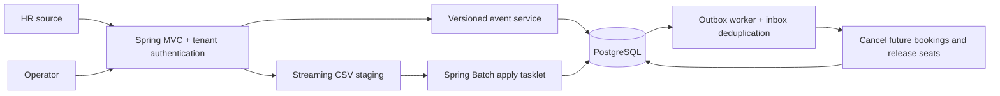

# Design note

## Components



The controller owns transport/authorization boundaries. RosterService owns live-update decisions and the transaction across EmployeeRepository and OutboxRepository. OutboxWorker owns the delivery transaction across OutboxRepository and BookingRepository, including the retry savepoint. These concrete repositories encapsulate JDBC operations without independent transaction boundaries or a generic repository/interface hierarchy. Core record validation is independent of Spring. Bulk reconciliation SQL remains together in SnapshotService; simple administrative endpoint queries remain in Api. This scoped extraction separates the main workflows without adding an abstraction for every query.

## Hardest flow: safe reconciliation racing live events

```mermaid
sequenceDiagram
  participant HR
  participant API
  participant DB as PostgreSQL
  participant OP as Operator
  participant W as Outbox worker
  HR->>API: CSV + complete-through watermark
  API->>DB: Stage validated rows in bounded batches
  API->>DB: Begin transaction; lock tenant row
  API->>DB: Count missing active rows at or below watermark
  alt Missing ratio exceeds threshold
    API->>DB: Persist BLOCKED; commit without employee changes
    OP->>API: Approve run with reason
    API->>DB: Relock tenant; recalculate against current state
  end
  API->>DB: Upsert newer rows; preserve admin fields
  API->>DB: Deactivate eligible absent rows + insert outbox
  API->>DB: Advance watermark and commit
  W->>DB: Lock pending event; insert unique inbox receipt
  W->>DB: Cancel booking, release seat, mark delivered; commit
```

## Failure modes

| Failure | Visible result | Recovery |
|---|---|---|
| Duplicate/stale live event | IGNORED | No database mutation |
| Bad employee fields | Per-record REJECTED code | Other records proceed; repair and resend |
| Malformed CSV syntax | FAILED run; no employee changes | Re-upload corrected file |
| Invalid/duplicate CSV records | PARTIAL or BLOCKED | No absence deactivation; fix and upload complete file |
| Truncated but syntactically valid export | BLOCKED when threshold reached | Operator verifies source before approval |
| Crash during staging | STAGING run; employees unchanged | Re-upload; stale staging retained for inspection |
| Crash during apply | Whole apply transaction rolls back | Resume STAGED run or re-upload |
| Lost HTTP response after commit | Client uncertain | Replay is idempotent |
| Crash after employee commit, before delivery | Durable pending outbox | Worker resumes after restart |
| Failure during booking cancellation | No partial receipt/effect committed | Durable retry backoff, then operator replay |
| Database unavailable | Generic API error; no invented success | Retry when DB returns |
| New live update while snapshot applies | Waits for same-tenant lock | Applied afterward if above committed watermark |

## Complexity and trade-offs

Let N be snapshot rows, M stored tenant employees, C=1,000 chunk rows, and O tenant office count. Streaming validation costs O(N), with O(C+O) application record storage. B-tree staging inserts typically cost O(N log N). Indexed set reconciliation depends on the PostgreSQL execution plan (hash/merge/nested joins); expected full-snapshot work is approximately linear scans plus index writes, not an all-pairs comparison. Database staging storage is O(N). The database may spill sorts/hash joins to disk; JVM heap bounds do not bound PostgreSQL memory.

Live ingestion uses indexed lookups/upserts, approximately O(log M), and a tenant serialization point. Large reconciliation transactions block live writes for that tenant while applying, though staging does not. This design is suitable for the case-study scale; a production high-throughput source would need per-employee coordination plus a snapshot barrier instead of the tenant-wide lock.

Consistency is strong for an individual committed HR change and its outbox entry, and eventual for booking effects. No external exactly-once delivery is claimed. Adding a broker requires publisher acknowledgments and the same idempotent inbox at each downstream consumer.

Safety detection is a heuristic: a truncated export below the threshold can still appear complete. A production source manifest with expected row count and checksum would strengthen completeness detection. Invalid rows disable absence processing to avoid turning validation errors into accidental departures.

The watermark assumption is deliberate: without a comparable source revision/cutoff, safely combining nightly absence with racing real-time updates is ambiguous. Stale-event rejection alone does not solve that problem.

Local office data is cached only for one staging run. Employee records are not cached because stale versions or ownership state would complicate correctness. Outbox/state tables require a production archival policy; this submission keeps history for inspection. Booking seat release is modeled by `seat_reserved=false`, not a complete vehicle-capacity scheduling system.

Operational signals: `roster.events`, `roster.snapshots.blocked`, `roster.snapshot.apply`, `roster.outbox.pending`, `roster.outbox.delivered`, `roster.outbox.failures`, standard HTTP/Hikari/JVM metrics. Structured logs carry identifiers and outcomes, never employee field values. Operators inspect BLOCKED runs and outbox attempts via tenant-scoped endpoints.
