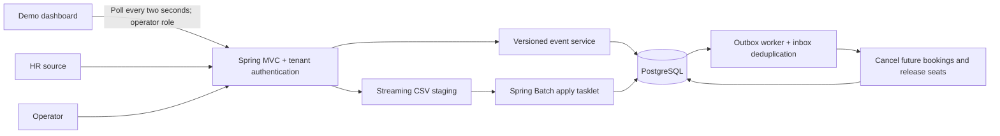

# Design note

## Components



The controller owns only transport and authorization boundaries. RosterService owns live-update decisions and the transaction across EmployeeRepository and OutboxRepository. BookingService owns booking validation and its transaction. DashboardService composes tenant-scoped repository reads, while OperationsService orchestrates reconciliation jobs and operator actions. OutboxWorker owns the delivery transaction across OutboxRepository and BookingRepository, including the retry savepoint. Core record validation is independent of Spring. Bulk, set-oriented reconciliation SQL remains cohesive in SnapshotService; Api contains no JDBC or transaction code.

OrderingPolicy delegates through the OrderingStrategy interface to VersionOrderingStrategy or TimestampOrderingStrategy. This is deliberate subtype polymorphism around a real variation point. State is encapsulated in immutable records and private final collaborators; Invalid extends RuntimeException to integrate domain errors with Java's exception model. Generic CRUD base classes were avoided because they would hide the workflow-specific queries without adding substitutable behavior.

## Hardest flow: safe reconciliation racing live events

```mermaid
sequenceDiagram
  participant HR
  participant API
  participant DB as PostgreSQL
  participant OP as Operator
  participant W as Outbox worker
  HR->>API: CSV + complete-through watermark
  API->>DB: Stage validated rows in bounded batches
  API->>DB: Begin transaction; lock tenant row
  API->>DB: Count missing active rows at or below watermark
  alt Missing ratio exceeds threshold
    API->>DB: Persist BLOCKED; commit without employee changes
    OP->>API: Approve run with reason
    API->>DB: Relock tenant; recalculate against current state
  end
  API->>DB: Upsert newer rows; preserve admin fields
  API->>DB: Deactivate eligible absent rows + insert outbox
  API->>DB: Advance watermark and commit
  W->>DB: Lock pending event; insert unique inbox receipt
  W->>DB: Cancel booking, release seat, mark delivered; commit
```

## Failure modes

| Failure | Visible result | Recovery |
|---|---|---|
| Duplicate/stale live event | IGNORED | No database mutation |
| Bad employee fields | Per-record REJECTED code | Other records proceed; repair and resend |
| Malformed CSV syntax | FAILED run; no employee changes | Re-upload corrected file |
| Invalid/duplicate CSV records | PARTIAL or BLOCKED | No absence deactivation; fix and upload complete file |
| Truncated but syntactically valid export | BLOCKED when threshold reached | Operator verifies source before approval |
| Crash during staging | STAGING run; employees unchanged | Re-upload; stale staging retained for inspection |
| Crash during apply | Whole apply transaction rolls back | Resume STAGED run or re-upload |
| Lost HTTP response after commit | Client uncertain | Replay is idempotent |
| Crash after employee commit, before delivery | Durable pending outbox | Worker resumes after restart |
| Failure during booking cancellation | No partial receipt/effect committed | Durable retry backoff, then operator replay |
| Database unavailable | Generic API error; no invented success | Retry when DB returns |
| Connection or statement timeout | Transaction rolls back; stable generic error | Client safely retries; durable due outbox rows remain available |
| New live update while snapshot applies | Waits for same-tenant lock | Applied afterward if above committed watermark |

## Complexity and trade-offs

Let N be snapshot rows, M stored tenant employees, C=1,000 chunk rows, and O tenant office count. Streaming validation costs O(N), with O(C+O) application record storage. B-tree staging inserts typically cost O(N log N). Indexed set reconciliation depends on the PostgreSQL execution plan (hash/merge/nested joins); expected full-snapshot work is approximately linear scans plus index writes, not an all-pairs comparison. Database staging storage is O(N). The database may spill sorts/hash joins to disk; JVM heap bounds do not bound PostgreSQL memory.

Live ingestion uses indexed lookups/upserts, approximately O(log M), and a tenant serialization point. Large reconciliation transactions block live writes for that tenant while applying, though staging does not. This design is suitable for the case-study scale; a production high-throughput source would need per-employee coordination plus a snapshot barrier instead of the tenant-wide lock.

Consistency is strong for an individual committed HR change and its outbox entry, and eventual for booking effects. No external exactly-once delivery is claimed. Adding a broker requires publisher acknowledgments and the same idempotent inbox at each downstream consumer.

Safety detection is a heuristic: a truncated export below the threshold can still appear complete. A production source manifest with expected row count and checksum would strengthen completeness detection. Invalid rows disable absence processing to avoid turning validation errors into accidental departures.

The ordering policy supports version and timestamp sources. `VERSION_PREFERRED` selects a version when an event supplies both; `VERSION_ONLY` and `TIMESTAMP_ONLY` enforce one input shape. The selected kind is persisted with employees, snapshot runs, outbox events, and bookings. A tenant cannot mix kinds, because there is no safe comparison between an arbitrary revision and an instant. Version sources need a shared snapshot watermark; timestamp sources need a complete-through timestamp from the same authoritative HR clock. These are integration preconditions rather than guarantees in the case study. The demo also expects full-state events.

Office reference data is cached in two bounded ways: a set scoped to one staging run and a cross-request Caffeine cache for live event lookups. The cross-request key contains tenant and office, is capped at 10,000 entries, and expires 60 seconds after write; both positive and negative lookups can therefore be stale for at most 60 seconds after an out-of-band office change. There is no office mutation API, so no local invalidation path is required. Employee records, ordering watermarks, bookings and outbox state are not cached because staleness would compromise correctness. Outbox/state tables require a production archival policy; this submission keeps history for inspection. Booking seat release is modeled by `seat_reserved=false`, not a complete vehicle-capacity scheduling system.

Operational signals: `roster.events{result=REJECTED}` for source rejections; `roster.outbox.pending` for queue depth; `roster.outbox.oldest.seconds` for lag; `roster.outbox.exhausted` for manual-intervention backlog; `roster.outbox.delivery.attempts{result=SUCCESS|FAILURE}` for delivery error rate; `roster.outbox.retries` for retry volume; `roster.snapshots.blocked`; `roster.snapshot.apply`; and standard HTTP, Hikari and JVM metrics. Structured logs carry tenant, employee/run identifiers, outcomes and exception types, never submitted employee field values or exception messages. Operators inspect BLOCKED runs and outbox attempts through tenant-scoped endpoints.
